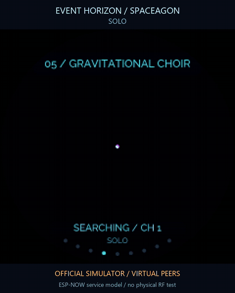
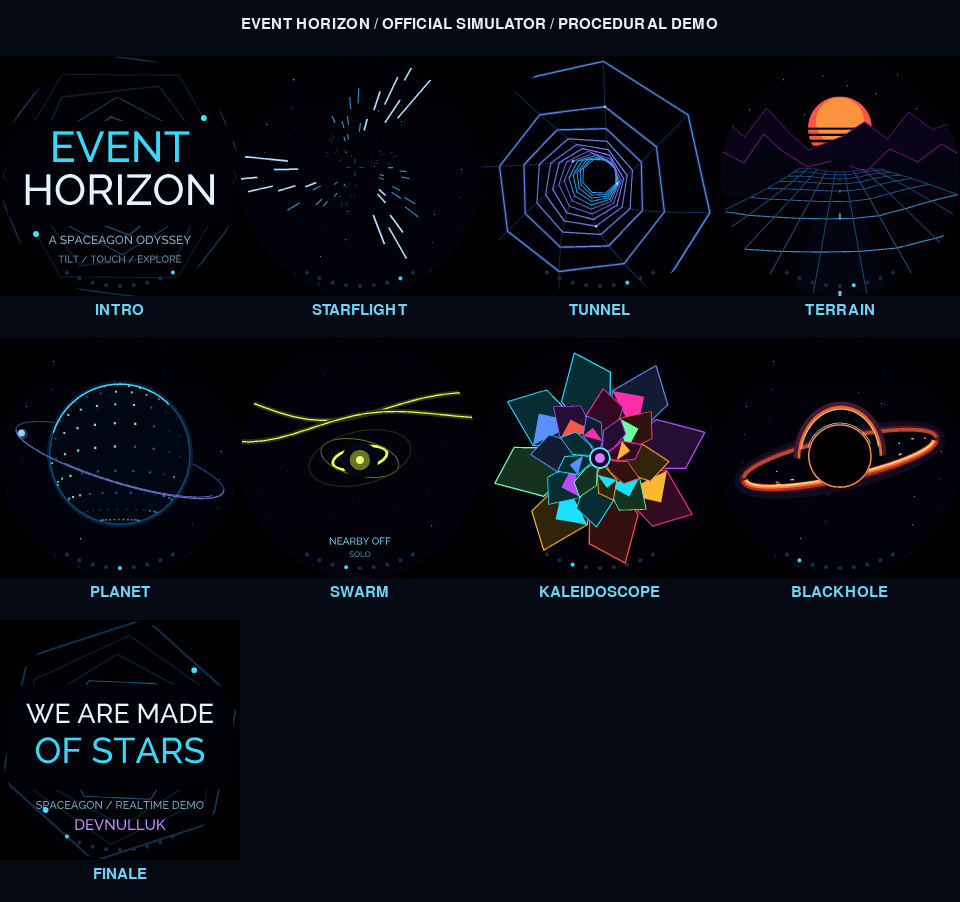

# Event Horizon

**Nearby compatibility:** version 0.2.1 uses ESP-NOW. Participating badges need
matching releases on the same current 2.4 GHz channel. The earlier Bluetooth
beta is withdrawn after native reset failures and is not interoperable; its
underlying reset cause remains unproven. The ESP-NOW implementation completed
a [679-second native full-show test](docs/VALIDATION.md) across all nine chapters
with zero recorded errors.

**RF verification limit:** an ESP-NOW exchange between two physical badges
has not been verified. Multi-peer tests and the film use synthetic peers.

A 140-second procedural odyssey for Spaceagon and Tildagon. Fly through stars,
dive into a geometric tunnel, skim neon terrain, orbit a rotating planet and
awaken a constellation with nearby badges. The round LCD, outer LEDs and
optional hexpansions follow one 120 BPM score.

**[Install from the App Store](https://apps.badge.emfcamp.org/apps/21344014/): code `21344014`.**



[Watch the nearby-badge simulator preview](docs/gallery/swarm-preview.mp4) ·
[Nearby guide](docs/SWARM.md) ·
[Controls](docs/CONTROLS.md) · [Simulator](simulator/README.md) ·
[Native validation](docs/VALIDATION.md)



Every scene is generated live from geometry, particles and cached mathematics.
The app works offline and needs no SD card. Spaceagon adds joystick, touch-ring
navigation and relative tilt; the six physical buttons also work on Tildagon.
The show loops after 140 seconds and can be paused, boosted or explored one
scene at a time.

## Nine chapters

| Chapter | Time | Scene |
| --- | --- | --- |
| Opening | 0–8 s | Orbital title sequence |
| Departure | 8–24 s | Perspective starflight and particle trails |
| Hyperspace | 24–40 s | Rotating geometric tunnel |
| Signal Lost | 40–56 s | A moving wireframe terrain |
| New Worlds | 56–72 s | A rotating 3D point planet and satellite |
| Gravitational Choir | 72–92 s | Nearby stars, aurora, resonance links and shared novas |
| Crystal Mind | 92–108 s | Radial kaleidoscope geometry |
| Event Horizon | 108–128 s | Lensing rings and an animated accretion disk |
| Finale | 128–140 s | The closing star sequence |

The black hole is cinematic artwork. The planet is a synthetic world; the
scenes are not scientific measurements or a live sky map.

## Nearby badges

Nearby mode is on by default and can be switched off in settings. Version 0.2.1
uses **ESP-NOW over the 2.4 GHz Wi-Fi radio** to share a sampled beat and colour
and react to local or remote boosts. **All participating badges must run a
matching release on the same current channel**, shown as **CH** in the HUD or
constellation page. The same SSID is not sufficient when access points use
different channels. The app observes the channel and never changes it. The old
Bluetooth beta does not interoperate; update participating badges together.

Press A briefly or move the Spaceagon joystick up to launch a nova. The new chapter
turns the group into a luminous constellation; other chapters receive small
interaction overlays. The show also works alone or with Nearby off.

No internet, router, pairing, account, cloud service or SD card is required by
the exchange. A station connected to an access point follows that access
point's channel. The app prefers the firmware's shared ESP-NOW broker where
available; otherwise it can claim an inactive raw singleton, refusing another
active owner. It may activate STA and temporarily adjust its power saving,
with conditional restoration, but never writes a channel, SSID, credentials or connect/disconnect
request. The raw fallback leaves STA active on exit. Nearby off does not mean
all shared Wi-Fi services are off.

Each badge keeps its own chapter and pause controls. Up to twelve recent peers
are represented, and peers expire after six seconds without a fresh message.
Constellation positions are artistic rather than measurements of distance or
bearing. See [SWARM.md](docs/SWARM.md) for usage, status messages, protocol and
the distinction between simulator demonstrations and physical radio checks.

## On the badge

Install **Event Horizon** through the badge App Store, then launch it from the
Media category. The [publication guide](docs/PUBLISHING.md) explains the source
archive and listing checks used for a release. For a manual development install,
keep all root runtime `.py` files, `tildagon.toml` and `LICENSE` together in one
app directory, then restart the launcher.

| Physical button | Action |
| --- | --- |
| A | Short press: boost; hold: settings |
| B / E | Next / previous chapter |
| C | Pause / resume |
| D | Show / hide the HUD |
| F | Exit |

With Spaceagon, move the joystick left/right to change chapter, press it to
pause, move up to boost or down to toggle the HUD. Tap the touch ring to select
a chapter or rotate across neighbouring pads to browse. Relative tilt shifts
the camera and can be disabled. Full mappings, settings and keyboard controls
are in [CONTROLS.md](docs/CONTROLS.md).

Settings provide separate ring, EEH Logo and Liteloop brightness, a detail
ceiling, tilt and Nearby on/off. Fresh brightness defaults are 15%, 3% and 12%
respectively; saved local preferences take precedence. Adaptive detail can
reduce drawing work within the chosen ceiling. Visual boosts respect the
brightness levels.

Recognized EEH Logo and Liteloop expansions receive their own choreographed
light layers. They are optional. A running manufacturer driver takes
precedence, and matrix transfers yield between bounded register updates.
Stopping the show darkens its ring and logo and attempts a bounded matrix
blanking transfer.

## Film and soundtrack

The current nearby preview runs one production app instance with two virtual
peer models through the official SDL/ctx simulator, using in-memory packet
delivery
and a synthetic matching channel. It does not exercise physical ESP-NOW or its
native scheduling. It is not footage of three physical badges or a measurement
of radio range or physical frame rate. The
[gallery notes](docs/gallery/README.md) describe the virtual hardware and capture
provenance.

The original 0.1 [48-second trailer](docs/media/event-horizon-trailer.mp4) and
[120-second film](docs/media/event-horizon-full.mp4) remain as historical
recordings of the earlier eight-chapter edition. They do not include Nearby
mode or the new chapter.

**Signal Beyond** is an original 120 BPM generative synth/chiptune score, with
pads, arpeggios, bass and synthesized percussion. It accompanies the videos;
the badge app does not play a soundtrack or assume audio hardware. The
[composition source and provenance](docs/COMPOSITION.md) explain how to render
the original 48- and 120-second arrangements using Python's standard library.
Those arrangements are video soundtracks, not the length of the new live show.
GIF previews are silent.

## Development

CPython 3.14 runs the hardware-independent checks without extra packages:

```sh
python -m unittest discover -s tests
python -m compileall -q .
python tools/validate_manifest.py
```

After committing the complete package, validate the archive the store will
actually download:

```sh
python tools/validate_manifest.py --git-ref HEAD
```

CI runs those checks against the commit. `.gitattributes` keeps the public
repository's documentation, simulator, tests and media out of the source
archive: only root runtime Python files, the manifest and licence are exported.
The validator checks imports, the exported app class, archive contents and
bounded download/runtime sizes.

The [portable simulator](simulator/README.md) uses a separately prepared,
pinned CPython 3.10 environment. It does not connect to a badge. Runtime scenes
use native ctx drawing and cached geometry rather than downloaded artwork.

[MIT licence](LICENSE). Original procedural visuals and music by **devnulluk**
with Codex. Simulator artwork attribution is recorded in the
[gallery notes](docs/gallery/README.md).
