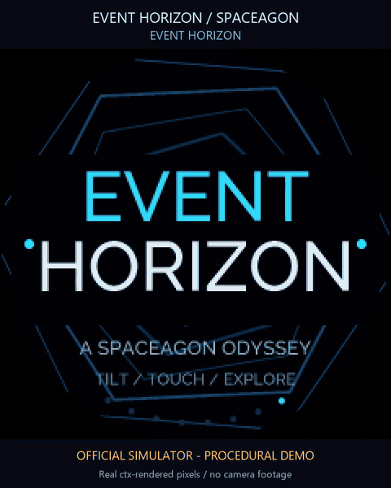

# Event Horizon

A two-minute procedural odyssey for Spaceagon and Tildagon. Fly through a star
field, dive into a geometric tunnel, skim a wireframe landscape and orbit a
rotating point planet before the black-hole finale. The round LCD, outer LEDs
and optional hexpansions follow one 120 BPM score.



[Watch the trailer with original music](docs/media/event-horizon-trailer.mp4) ·
[Watch the full two-minute film](docs/media/event-horizon-full.mp4) ·
[Controls](docs/CONTROLS.md) · [Simulator](simulator/README.md) ·
[Native validation](docs/VALIDATION.md)


Every scene is generated live from geometry, particles and cached mathematics.
The app works offline and needs no SD card. Spaceagon adds joystick, touch-ring
navigation and relative tilt; the six physical buttons also work on Tildagon.
The show loops after 120 seconds and can be paused, boosted or explored one
scene at a time.

## Eight chapters

| Chapter | Time | Scene |
| --- | --- | --- |
| Opening | 0–8 s | Orbital title sequence |
| Departure | 8–24 s | Perspective starflight and particle trails |
| Hyperspace | 24–40 s | Rotating geometric tunnel |
| Signal Lost | 40–56 s | A moving wireframe terrain |
| New Worlds | 56–72 s | A rotating 3D point planet and satellite |
| Crystal Mind | 72–88 s | Radial kaleidoscope geometry |
| Event Horizon | 88–108 s | Lensing rings and an animated accretion disk |
| Finale | 108–120 s | The closing star sequence |

The black hole is cinematic artwork. The planet is a synthetic world; the
scenes are not scientific measurements or a live sky map.

## On the badge

Install **Event Horizon** through the badge App Store, then launch it from the
Media category. The [publication guide](docs/PUBLISHING.md) explains the source
archive and listing checks used for a release. For a manual development install,
keep all root runtime `.py` files, `tildagon.toml` and `LICENSE` together in one
app directory, then restart the launcher.

| Physical button | Action |
| --- | --- |
| A | Short press: boost; hold: settings |
| B / E | Next / previous chapter |
| C | Pause / resume |
| D | Show / hide the HUD |
| F | Exit |

With Spaceagon, move the joystick left/right to change chapter, press it to
pause, move up to boost or down to toggle the HUD. Tap the touch ring to select
a chapter or rotate across neighbouring pads to browse. Relative tilt shifts
the camera and can be disabled. Full mappings, settings and keyboard controls
are in [CONTROLS.md](docs/CONTROLS.md).

Settings provide separate ring, EEH Logo and Liteloop brightness, a detail
ceiling and tilt on/off. Fresh brightness defaults are 15%, 3% and 12%
respectively; saved local preferences take precedence. Adaptive detail can
reduce drawing work within the chosen ceiling. Visual boosts respect the
brightness levels.

Recognized EEH Logo and Liteloop expansions receive their own choreographed
light layers. They are optional. A running manufacturer driver takes
precedence, and matrix transfers yield between bounded register updates.
Stopping the show darkens its ring and logo and attempts a bounded matrix
blanking transfer.

## Film and soundtrack

The gallery and films are recordings of the official SDL/ctx simulator running
the production app. They are not camera footage or physical badge frame-rate
measurements. The 48-second trailer visits all eight chapters in six-second
cuts; the full film follows the unmodified 120-second show. The
[gallery notes](docs/gallery/README.md) describe the virtual hardware and capture
provenance.

**Signal Beyond** is an original 120 BPM generative synth/chiptune score, with
pads, arpeggios, bass and synthesized percussion. It accompanies the videos;
the badge app does not play a soundtrack or assume audio hardware. The
[composition source and provenance](docs/COMPOSITION.md) explain how to render
either score using Python's standard library. GIF previews are silent.

## Development

CPython 3.14 runs the hardware-independent checks without extra packages:

```sh
python -m unittest discover -s tests
python -m compileall -q .
python tools/validate_manifest.py
```

After committing the complete package, validate the archive the store will
actually download:

```sh
python tools/validate_manifest.py --git-ref HEAD
```

CI runs those checks against the commit. `.gitattributes` keeps the public
repository's documentation, simulator, tests and media out of the source
archive: only root runtime Python files, the manifest and licence are exported.
The validator checks imports, the exported app class, archive contents and
bounded download/runtime sizes.

The [portable simulator](simulator/README.md) uses a separately prepared,
pinned CPython 3.10 environment. It does not connect to a badge. Runtime scenes
use native ctx drawing and cached geometry rather than downloaded artwork.

[MIT licence](LICENSE). Original procedural visuals and music by **devnulluk**
with Codex. Simulator artwork attribution is recorded in the
[gallery notes](docs/gallery/README.md).
